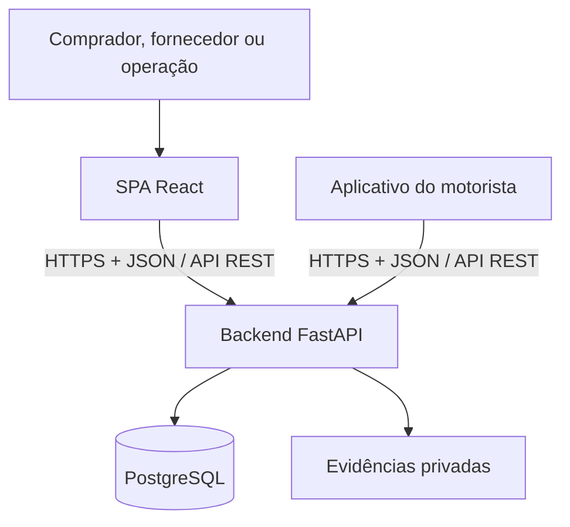

# RotaLog Frontend

Portal web responsivo do **RotaLog**, utilizado por empresas compradoras, fornecedores/distribuidoras e operadores da plataforma para acompanhar e executar as jornadas comerciais e logísticas do marketplace B2B.

> **Estado atual:** o portal é uma SPA em React, TypeScript e Vite. Em `VITE_AUTH_MODE=api`, o comprador autenticado consulta produtos, ofertas, lista e detalhes de compras no Backend conforme as capacidades da organização e pode enviar solicitações de checkout e confirmação explícita. A análise estática do Backend no commit 5dda7eaed56185509382113f66b6807cc97fe30d considerou compatíveis os contratos de login, catálogo, produtos, ofertas, estoque, checkout, compras e pedidos. Nesse commit, confirm-payment usa pagamento simulado, sem PSP externo, mas grava compra, pedidos, pagamento e alocações e converte reservas. A compatibilidade com o ambiente publicado ainda precisa ser validada. O modo `mock` mantém as telas locais de demonstração.

## Para quem é o portal

- **Comprador:** consulta catálogo, compara ofertas, realiza checkout e acompanha pedidos, pagamentos, entregas e contestações.
- **Fornecedor:** administra ofertas, estoque e capacidade; aceita pedidos; registra separação, prontidão e retornos.
- **Operação RotaLog:** planeja e publica rotas, acompanha exceções, provas pendentes, disputas, jobs e auditoria.
- **Perfis administrativos:** gerenciam organizações e ações autorizadas conforme papéis e capacidades definidos pelo backend.

## Responsabilidades

- oferecer jornadas responsivas e acessíveis para os diferentes perfis;
- consumir a API REST do backend sem acessar banco ou arquivos diretamente;
- apresentar separadamente estados comerciais, financeiros, de custódia e de disputa;
- tratar loading, vazio, erro recuperável e falta de permissão;
- confirmar ações críticas e impedir reenvios acidentais;
- exibir contadores com horário absoluto, fuso e tempo restante;
- carregar evidências privadas somente sob demanda e mediante autorização;
- sinalizar claramente dados sintéticos e ações simuladas;
- manter os tipos de integração compatíveis com o OpenAPI canônico.

## Arquitetura e comunicação



O frontend e o mobile não se comunicam diretamente. Eles observam o mesmo fluxo por meio da API:

1. o portal cria ou atualiza pedidos, rotas e decisões autorizadas;
2. o backend valida as regras e persiste a mudança;
3. o aplicativo do motorista consulta rotas e envia tentativas/provas;
4. o portal consulta o estado consolidado e a timeline autorizada.

O OpenAPI do backend é o contrato canônico. O portal deve utilizar tipos gerados e um wrapper HTTP fino quando essa etapa estiver implementada. A baseline usa HTTP; WebSocket não é requisito da demonstração.

## Funcionalidades do portal

### Comprador

- login API autorizado por organização e capacidade;
- catálogo, detalhes e ofertas lidos da API;
- lista e detalhes de compras e pedidos vinculados, em modo somente leitura;
- carrinho, criação de checkout, consulta e confirmação explícita no modo API;
- catálogo, busca e filtros locais no modo de demonstração.

No Backend do commit 5dda7eaed56185509382113f66b6807cc97fe30d, confirm-payment usa captura simulada, sem PSP externo. A confirmação, apesar de simulada, grava compra, pedidos, pagamento e alocações e converte as reservas de estoque/capacidade. O Frontend depende de janelas de capacidade previamente existentes; criação e ajuste dessas janelas não estão disponíveis na interface. Compatibilidade com o ambiente publicado ainda precisa ser validada. Entrega, retorno, reentrega, reembolso e contestação não estão implementados nesta jornada Frontend.

### Fornecedor

- consulta de catálogo, gestão de ofertas e depósitos;
- consulta e ajuste de estoque declarado;
- fila de pedidos, aceite/recusa, separação e prontidão;
- dashboard e lista de pedidos prontos para coleta.

A revisão administrativa de geocodificação dos depósitos não está disponível no Frontend. Capacidade logística também não pode ser criada ou ajustada pela interface. A tela de Rotas do fornecedor lista pedidos prontos. O portal separado do planejador consulta rotas canônicas, manifesto e rastreamento registrado. As imagens canônicas são consultadas na API com autenticação; IndexedDB permanece exclusivo do fluxo legado.

### Administração

- cadastro e publicação de produtos no catálogo canônico;
- leitura do catálogo publicado.
- exibição autenticada de imagens e gerenciamento da galeria administrativa, incluindo upload, principal, ordenação e remoção de associação.

O planejador possui consulta, detalhes, manifesto e rastreamento de rotas. O formulário B02.4/B02.5 permite revisão visual; criação, aprovação e publicação ficam bloqueadas até existir consulta autorizada de lotes elegíveis e isolamento por fornecedor no backend. Provas de entrega, disputas, gestão de frota e controle de jobs não estão completos na interface.

No piloto, o portal adicionará compra multi-fornecedor, operações parciais, integração ERP, propostas de rota otimizadas e mapa de rastreamento autorizado.

## Stack

### Presente no repositório

| Área | Tecnologia |
|---|---|
| Linguagem | TypeScript 6 em modo estrito |
| UI | React 19 |
| Build e desenvolvimento | Vite 8 |
| Rotas | React Router 7 |
| Qualidade estática | Oxlint |
| Compilação | React Compiler |
| Gerenciador de pacotes | npm com `package-lock.json` |
| Testes de renderização | Vitest, Testing Library e jsdom |
| Testes ponta a ponta | Playwright |

### Dependências e evolução

- TanStack Query para estado remoto;
- React Hook Form e Zod para formulários e validação de fronteira;
- shadcn/ui sobre Radix UI;
- Tailwind CSS;
- tipos e cliente gerados a partir do OpenAPI do backend.

TanStack Table só será adicionado se as telas administrativas exigirem seleção, ordenação ou colunas complexas. Next.js não faz parte da arquitetura: o portal é uma SPA autenticada sem necessidade de SSR ou SEO relevante.

## Organização prevista

```text
src/
  app/          # router, providers e bootstrap
  features/     # auth, catalog, checkout, orders, routes, disputes e demo
  shared/       # UI, cliente API, validação e utilidades
```

Evite criar uma camada `entities` que apenas replique os tipos gerados pelo OpenAPI ou os modelos específicos de cada feature.

## Requisitos locais

- Git;
- Node.js **20.19+** ou **22.12+**;
- npm, utilizando o lockfile versionado;
- backend em execução quando a integração HTTP estiver habilitada.

## Configuração e execução local

```bash
git clone https://github.com/Uninorte-Extensao/rotalog-frontend.git
cd rotalog-frontend

npm ci
npm run dev
```

O Vite exibirá no terminal o endereço local, normalmente `http://localhost:5173`.

Comandos disponíveis:

```bash
npm run dev      # servidor de desenvolvimento com HMR
npm run build    # type check e build de produção
npm run lint     # análise estática com Oxlint
npm run typecheck # validação de tipos TypeScript
npm test         # testes unitários e de renderização
npm run preview  # prévia local do build gerado
```

Configure a aplicação por variáveis de ambiente do Vite. O `.env.example` documenta as variáveis públicas, sem credenciais. Arquivos `.env` e `.env.*` são locais e ignorados, exceto `.env.example`. Não coloque tokens ou credenciais em variáveis `VITE_*`.

Todo `npm run build` exige `VITE_AUTH_MODE=api` e `VITE_API_URL` absoluta HTTP/HTTPS explícita. Não existe fallback de build para mock ou localhost. O exemplo usa mock somente para `npm run dev`; para validar um build local, configure explicitamente `api` e `http://localhost:8000`. Os workflows de CI usam esses valores locais para compilação e testes, sem deploy. Para publicação, a URL HTTPS real deve ser configurada no ambiente do build.

Detalhes: [configuração do build](docs/deploy-configuration.md), [divisão e medidas dos bundles](docs/bundle-loading.md) e [pendências de categorias e produtos no backend](docs/rotalog-v5-pendencias-backend-categorias-produtos.md). As páginas são carregadas sob demanda por portal, com status de carregamento e tratamento de falhas. ExcelJS só é solicitado nas ações de planilha.

Para iniciar a partir do exemplo, copie `.env.example` para `.env.local`:

```powershell
Copy-Item .env.example .env.local
npm run dev
```

Use estas variáveis em `.env.local`:

```dotenv
VITE_AUTH_MODE=mock
VITE_API_URL=http://localhost:8000
```

`VITE_AUTH_MODE` aceita `mock` ou `api`; o modo `mock` é o padrão para desenvolvimento local. `VITE_API_URL` é a URL base do Backend (sem o prefixo `/api/v1`). Para usar a API local, configure `VITE_AUTH_MODE=api` e mantenha `VITE_API_URL=http://localhost:8000`. O modo API exige uma sessão autorizada e uma organização com pelo menos uma capacidade de comprador (`catalog:read` ou `purchase:read`); cada tela exige sua capacidade correspondente. Reinicie o Vite após alterar variáveis.

## Regras de UX e segurança

- o backend é a autoridade final para permissões e ações permitidas;
- `allowed_actions` pode orientar a interface, mas nunca substitui autorização;
- botões de comando ficam desabilitados após o envio;
- ações relevantes exigem confirmação explícita;
- prova pendente não deve parecer uma entrega concluída;
- resultado provisório não deve parecer definitivo;
- cor não pode ser o único indicador de estado;
- dados sensíveis, tokens e evidências não devem ser registrados no console;
- o portal deve ser responsivo a partir de 360 px, com operação priorizando desktop;
- as jornadas principais devem buscar conformidade WCAG 2.2 AA.

## Repositórios relacionados

- Backend: https://github.com/Uninorte-Extensao/rotalog-backend
- Frontend: https://github.com/Uninorte-Extensao/rotalog-frontend
- Mobile: https://github.com/Uninorte-Extensao/rotalog-mobile
- Board de implementação: https://trello.com/b/4NmXZdXn/rotalog

## Contribuição

1. Escolha uma task no Backlog e confirme o grupo de entrega.
2. Verifique se o endpoint e o schema OpenAPI necessários já estão disponíveis.
3. Implemente estados de carregamento, vazio, erro e acesso negado junto ao fluxo principal.
4. Execute lint e build antes de abrir o pull request.
5. Documente alterações de contrato ou dependências sobre backend e mobile.

## Validação

```bash
npm ci
npm test
npm run lint
npm run typecheck
npm run build
```

`npm test` executa os testes Node existentes e os testes de renderização do Vitest. Os testes de interface usam ambiente DOM e não dependem de uma API em execução. O workflow de pull request executa lint, typecheck, testes e build; a validação pós-merge executa testes e build.

## Issue #5 — estabilização do CI

Na etapa da Issue #5 foram corrigidos o nome do workflow, os scripts de validação, os testes de renderização e o exemplo de configuração local; catálogo/ofertas e lista/detalhe de compras foram integrados em modo somente leitura. Checkout e confirmação de pagamento não fizeram parte daquela etapa. A implementação posterior descrita neste README envia essas solicitações no modo API, sujeitas à validação dos contratos do Backend.

Referência: [Issue #5 — Estabilizar workflow, CI e primeiras telas](https://github.com/Uninorte-Extensao/rotalog-frontend/issues/5).


## ROT-027: autenticação com Backend local

Copie `.env.example` para `.env.local`. O padrão é `VITE_AUTH_MODE=mock`;
para autenticação real configure e reinicie o Vite:

```dotenv
VITE_AUTH_MODE=api
VITE_API_URL=http://localhost:8000
```

No diretório `rotalog-backend`, com o `.env` do backend configurado, execute
`docker compose up --build -d`. No frontend execute `npm ci` (se necessário)
e `npm run dev -- --host localhost`. Abra **http://localhost:5173/login**;
use o mesmo hostname `localhost` na API. O backend precisa permitir a origem
`http://localhost:5173` em sua configuração CORS, com cookies habilitados.
Não altere a configuração do backend sem revisar seu ambiente.

Entre com `fornecedor@rotalog.invalid` e a senha cadastrada, digitada no formulário.
Nenhuma senha dessa conta acompanha o frontend. Confira a identificação da sessão
no portal, recarregue para testar a restauração e use Sair para revogar a sessão.
Confira também senha incorreta e acesso direto a `/fornecedor` sem sessão.
Para voltar aos usuários de demonstração existentes, configure `mock` e reinicie.

Login, cadastro, refresh, logout, alteração de senha e `/api/v1/me` usam a API
no modo `api`. Para `BUYER_ADMIN`, catálogo/ofertas usam `GET /api/v1/products`,
`GET /api/v1/products/{product_id}` e `GET /api/v1/offers`; compras usam a leitura
paginada de `GET /api/v1/purchases` e `GET /api/v1/purchases/{purchase_id}`.
O comprador também consulta `GET /api/v1/capacity-slots` e envia solicitações
para `POST /api/v1/checkouts`, `GET /api/v1/checkouts/{checkout_id}` e
`POST /api/v1/checkouts/{checkout_id}/confirm-payment`. A interface envia a
confirmação após ação explícita. A análise estática dos routers, schemas,
serviços e testes do Backend no commit
`5dda7eaed56185509382113f66b6807cc97fe30d` considerou compatíveis os contratos
de login, catálogo, produtos, ofertas, estoque, checkout, compras e pedidos.
Nesse commit, confirm-payment usa pagamento simulado, sem PSP externo; a
operação ainda grava compra, pedidos, pagamento e alocações e converte
reservas. A compatibilidade do ambiente publicado ainda precisa ser validada.

A organização ativa é enviada no cabeçalho `X-Organization-Id`. Catálogo exige
`catalog:read`, carrinho/checkout exige `checkout:create` e compras exige
`purchase:read`; o login aceita comprador autorizado com `catalog:read` ou
`purchase:read`. As listas e detalhes de compras verificam o vínculo com a
organização. Para fornecedores, pedidos, produtos, ofertas, depósitos e estoque
usam a API. A revisão administrativa de depósitos e a criação/alteração de
capacidade logística não estão disponíveis no Frontend. A tela de Rotas lista
pedidos prontos, mas não planeja, atribui motorista ou rastreia. Imagens de
produtos são consultadas na API com autenticação; apenas o fluxo legado mantém imagens no IndexedDB.
A organização real vem de `/me`, sem associação artificial
com organizações mock; listas vazias não recebem dados de demonstração. Os dados
mock anteriores são preservados ao alternar os modos.

Criação de checkout e confirmação usam chaves de idempotência e não são
reenviadas automaticamente. Se o resultado ficar incerto, a interface exige
consulta antes de uma nova confirmação. O modo API não monta o carrinho mock.

O access token fica somente em memória e o refresh token fica no cookie HttpOnly
do backend. Apenas o valor CSRF retornado pelo login fica em `sessionStorage`
(`rotalog:api-csrf`), permitindo restaurar a sessão ao recarregar a mesma aba.
Uma aba nova sem esse valor exige login. Refresh usa `X-CSRF-Token`, cookies,
uma única promessa por aba e Web Locks para serializar abas quando disponível.
Falhas de refresh encerram a sessão local; falha de logout informa que a revogação
no servidor não pôde ser confirmada, mesmo com o estado local limpo.

O perfil e vínculo devem corresponder ao acesso solicitado. Para fornecedores,
a interface mapeia
`supplier_order:manage` para dashboard/pedidos, `offer:write` para produtos e
`inventory:write` para estoque. Rotas logísticas não recebem permissão implícita.
Para compradores, o perfil e vínculo devem ser `BUYER_ADMIN`; catálogo exige
`catalog:read` e compras exigem `purchase:read`.
Os seletores de usuários/organizações mock ficam ocultos em modo API.
A seleção entre múltiplas organizações reais não faz parte desta etapa.

Validações: `npm run typecheck`, `npm run lint` (Oxlint), `npm test`,
`npm run build`, `npm run test:e2e` e `npm run test:e2e:api`. Os testes de API
usam respostas interceptadas e não fazem compras, pagamentos ou alterações reais.

## ROT-027: pedidos reais do fornecedor

No modo `api`, Kanban, dashboard e menu compartilham uma única fonte em memória,
isolada por usuário/organização. Não há leitura ou gravação de pedidos no
localStorage ou IndexedDB, nem fallback para mocks. Logout/troca de identidade
desmonta essa fonte; respostas pendentes da sessão anterior são descartadas.
A autenticação existente é reutilizada sem outro login ou armazenamento de tokens.

### Contratos utilizados

Todas as rotas abaixo têm prefixo `/api/v1`; pedidos usam o Bearer existente e
`X-Organization-Id` obtido da sessão:

| Endpoint | Uso |
|---|---|
| `GET /supplier-orders?page=N&page_size=100` | Todas as páginas para os indicadores globais |
| `GET /supplier-orders/{id}` | Detalhes atualizados do pedido |
| `POST /supplier-orders/{id}/acceptance` | Aceite integral/parcial ou recusa integral |
| `POST /supplier-orders/{id}/start-separation` | Início da separação |
| `POST /supplier-orders/{id}/fulfillments` | Alocação explícita de quantidades em lote |
| `POST /fulfillments/{id}/separation-results` | Registro explícito das quantidades separadas |
| `POST /fulfillments/{id}/mark-ready` | Prontidão de um lote totalmente separado |

As operações ficam nos detalhes e exigem revisão e confirmação. Navegação,
carregamento, retorno à aba e atualização periódica executam somente consultas.
O botão de pedido de teste e as transições locais pertencem exclusivamente ao mock.
O endpoint de cancelamento existe, mas não foi integrado nesta etapa: recusa
integral usa `acceptance` com zero em todas as linhas e não solicita motivo que
esse contrato não aceita. Não há integração de transporte, entrega ou finanças.

### Estados e permissões

| Estado do backend | Apresentação |
|---|---|
| `AWAITING_SUPPLIER_DECISION` | Novos |
| `ACCEPTED`, `PARTIALLY_ACCEPTED` | Aceitos, preservando a indicação de parcial |
| `SEPARATING` | Em separação |
| `READY_TO_DISPATCH` | Prontos para coleta |
| `REFUSED`, `CANCELLED`, `ACCEPTANCE_EXPIRED` | Histórico, com o estado específico |
| Qualquer outro valor | Outros estados, com detalhes acessíveis |

`AWAITING_PAYMENT` não é retornado pela listagem atual do backend. O frontend
respeita `allowed_actions` e o prazo de aceite; não move cartões por arrastar.
O fulfillment não possui `allowed_actions` próprio no contrato: suas ações
dependem da autorização `fulfillments` do pedido, do estado `SEPARATING` de ambos
e das quantidades. O backend continua sendo a autoridade para cada operação.

### Precisão, concorrência e atualização

Valores monetários permanecem strings decimais no contrato. Formatação e
validação usam centavos com `bigint`, sem converter dinheiro para ponto flutuante.
Datas do contrato são preservadas com seu offset e o prazo é exibido em
`America/Manaus`. Não há datas de criação/conclusão, nome do comprador ou estado
financeiro nesse retorno; o portal não preenche essas lacunas com dados locais.

Aceite/recusa envia `Idempotency-Key` estável para a mesma combinação de pedido,
versão e linhas, inclusive após erro de conexão e nova confirmação. As chaves
ficam em memória na sessão do portal; payload ou versão diferente é outra ação.
Após recarregar, consulte o estado atualizado antes de decidir novamente.
Os outros endpoints não oferecem contrato de idempotência e não são repetidos
automaticamente em falhas de rede. Uma falha pode ter ocorrido após confirmação
no servidor: use **Atualizar pedido e revisar** antes de uma nova operação.

`expected_version` de aceite, início e criação de lote usa a versão do pedido;
separação e prontidão usam a versão do fulfillment. Respostas não são aplicadas
otimisticamente. Erros 400/401/403/404/409/422 têm mensagens específicas; conflitos
exigem consulta e revisão. Uma falha ao carregar qualquer página invalida a lista
completa e suas contagens, sem apresentar totais parciais como globais.

A fonte deduplica consultas em andamento e atualiza após operações, a cada 60
segundos, ao retornar à janela e pelo botão **Atualizar pedidos**. Todas as páginas
são percorridas antes de publicar contagens. Mudanças de total ou duplicidades
durante a paginação geram erro recuperável; a API não oferece snapshot ou
agregações, portanto mudanças concorrentes que mantenham o total podem escapar
dessa detecção. Consultar todas as páginas tem custo proporcional à base.

### Dashboard e validação no navegador

O dashboard API apresenta contagens globais, situação dos pedidos e os cinco
primeiros da ordenação do backend. Sem data de criação no contrato, não há filtro
anual nem séries temporais. O histórico de pedidos finalizados não inventa datas.
O dashboard mock, seus filtros, gráficos, produtos e dados locais são preservados.

1. Execute backend e frontend como descrito acima e entre com o fornecedor.
2. Em **Dashboard**, confira Pedidos recebidos e Aguardando aceite. Em **Pedidos**,
   confira a contagem da coluna Novos e o badge do menu: ambos devem corresponder
   a Aguardando aceite. Pedidos recebidos inclui também histórico/outros estados.
3. Zero pedidos mostra estado vazio e menu sem badge. Na aba Network, a consulta
   deve ir para `/api/v1/supplier-orders?page=1&page_size=100`; não compartilhe
   cabeçalhos de autenticação ou cookies.
4. Quando houver pedido sintético, abra seus detalhes e confira produtos, valores,
   prazo, estado e versões. Só confirme operações que deseje executar.
5. Para o fluxo operacional: aceitar → iniciar separação → criar lote com
   quantidades → registrar separação → marcar lote totalmente separado como pronto.
   Havendo múltiplos lotes, confirme cada um; o backend decide a prontidão do pedido.
6. Atualize as telas e compare os contadores. Em conflito, atualize os detalhes e
   revise antes de confirmar outra ação. Não use estoque mock para validar reserva
   de um pedido API: essa reserva pertence ao backend.

### Testes

```bash
npm run typecheck
npm run lint
npm test
npm run build
npm run test:e2e
npm run test:e2e:api
```

E2E mock usa `127.0.0.1:5174` e força `VITE_AUTH_MODE=mock`, independentemente do
`.env` local. E2E API usa `localhost:5175` e força modo API. Suas chamadas são
interceptadas no Playwright, inclusive escritas, sem alterar pedidos do backend.
O servidor manual em `localhost:5173` pode permanecer aberto. Nenhum teste
contém senha ou token de uma conta real.
